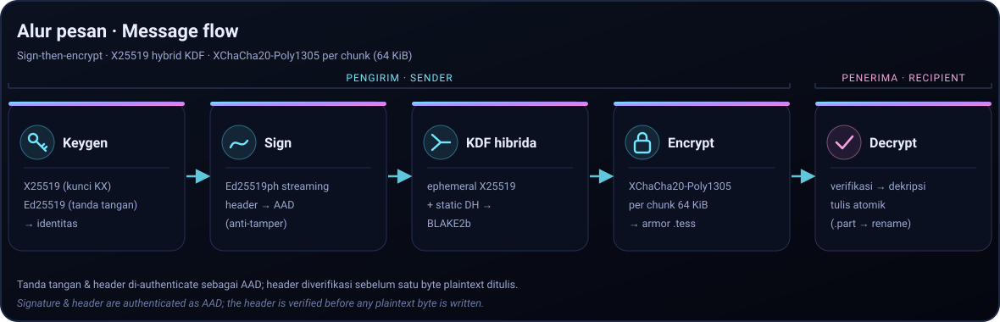

<p align="center">
  
</p>

# Tesseract Crypt

[](https://github.com/adyoi/tesseract-crypt/actions/workflows/ci.yml)
[](https://github.com/adyoi/tesseract-crypt/actions/workflows/pages.yml)
[](https://github.com/adyoi/tesseract-crypt/releases)
[](https://github.com/adyoi/tesseract-crypt/actions/workflows/codeql.yml)
[](LICENSE)

**Encrypt strings & files with public/private keys — modern hybrid, streaming, signed.**

> **Bahasa Indonesia:** [README.md](README.md) · dokumentasi ID:
> [https://adyoi.github.io/tesseract-crypt/id/](https://adyoi.github.io/tesseract-crypt/id/)

`libtesseract_crypt` (C11) + `tesseract-crypt` (CLI, C++17, short alias: `tscrypt`)
built on [libsodium](https://doc.libsodium.org/): X25519 *hybrid* encryption,
Ed25519 sign-then-encrypt, XChaCha20-Poly1305 AEAD per-chunk, and Argon2id for
passphrase mode.

| Feature | Description |
|---------|-------------|
| **Hybrid public-key** | Ephemeral X25519 (per-message forward secrecy) + static DH (identity binding) → BLAKE2b KDF → XChaCha20-Poly1305 |
| **Sign-then-encrypt** | Ed25519ph (streaming) signature lives in the header, which is authenticated as AAD |
| **Passphrase mode** | Argon2id (memory-hard) as symmetric fallback |
| **Streaming chunked** | 64 KiB per chunk, per-chunk subkey (`crypto_kdf`), constant memory, reorder/truncation detection |
| **PEM-like armor** | Base64 `-----BEGIN TESSERACT MESSAGE-----` for stdout & text |
| **Multi-recipient (v2)** | One message for many recipients: a random data key wrapped per recipient (format v2) |
| **Atomic output** | File is written to `.part`, renamed only after decryption & verification succeed |

## How it works



The signature and header are authenticated as AAD, and the header is verified
**before** any plaintext byte is written.

## Install (APT — Debian/Ubuntu amd64)

Prebuilt `tesseract-crypt` binaries are served from an APT repository hosted
on GitHub Pages and signed with GPG:

```bash
# 1. install the repository public key
curl -fsSL https://adyoi.github.io/tesseract-crypt/apt/tesseract-crypt.asc \
  | sudo gpg --dearmor -o /usr/share/keyrings/tesseract-crypt.gpg

# 2. register the repository
echo "deb [signed-by=/usr/share/keyrings/tesseract-crypt.gpg] https://adyoi.github.io/tesseract-crypt/apt stable main" \
  | sudo tee /etc/apt/sources.list.d/tesseract-crypt.list

# 3. install (the short alias tscrypt comes along)
sudo apt update
sudo apt install tesseract-crypt
```

> The repository is rebuilt (and re-signed) on every push to `main`.
> Verify the key: `gpg --show-keys /usr/share/keyrings/tesseract-crypt.gpg`
> → fingerprint `7C20 2758 4065 349E 9B1A 21A4 374E D7B8 C78B 6673`.

## Other package managers

| Manager | Platform | Command |
|---------|----------|---------|
| **Homebrew** | macOS, Linux | `brew tap adyoi/tap && brew install tesseract-crypt` |
| **Scoop** | Windows | `scoop bucket add adyoi https://github.com/adyoi/scoop-bucket` then `scoop install tesseract-crypt` |
| **Winget** | Windows | `winget install adyoi.tesseract-crypt` |
| **Chocolatey** | Windows | `choco install tesseract-crypt` |
| **RPM** | Fedora, RHEL, openSUSE | `dnf install ./tesseract-crypt-<version>-1.<arch>.rpm` (download from the release page) |
| **Arch** | Arch Linux | `curl -fsSLO https://github.com/adyoi/tesseract-crypt/releases/latest/download/PKGBUILD && makepkg -si` |

> The formula, manifests and PKGBUILD above are refreshed automatically from
> every release by the [`packages.yml`](.github/workflows/packages.yml) and
> [`release.yml`](.github/workflows/release.yml) workflows — companion repos:
> [`adyoi/homebrew-tap`](https://github.com/adyoi/homebrew-tap),
> [`adyoi/scoop-bucket`](https://github.com/adyoi/scoop-bucket).

## Download

Ready-to-use packages are available on
[GitHub Releases](https://github.com/adyoi/tesseract-crypt/releases):

| Platform | Architecture | File |
|----------|--------------|------|
| Windows | x64, x86, arm64 | `tesseract-crypt-<version>-Windows-<arch>.zip` |
| Windows (installer) | x64, x86 | `tesseract-crypt-<version>-windows-<arch>-setup.exe` |
| macOS | universal2 (Intel + Apple silicon) | `tesseract-crypt-<version>-macOS-universal2.tar.gz` |
| Linux | x86_64, i686, aarch64 | `tesseract-crypt-<version>-Linux-<arch>.tar.gz`, `tesseract-crypt_<version>_<deb-arch>.deb` |
| Linux (RPM) | x86_64, i686, aarch64 | `tesseract-crypt-<version>-1.<rpm-arch>.rpm` |
| Arch Linux | x86_64 | `PKGBUILD` (see [Other package managers](#other-package-managers)) |

> Every release ships a `SHA256SUMS` file for integrity verification.
> The Windows `.zip` bundles the `libsodium` runtime; Linux
> `.tar.gz`/`.deb`/`.rpm` link libsodium statically, so they all run with no
> extra dependencies.

### Verifying releases

Every release ships checksums, an SPDX SBOM, and Sigstore *build provenance*
you can verify:

```bash
# 1. match the checksums
sha256sum -c SHA256SUMS

# 2. verify an artifact's provenance (e.g. from tag v1.0.4)
gh attestation verify tesseract-crypt-1.0.4-Windows-x64.zip \
  --repo adyoi/tesseract-crypt

# 3. inspect the SPDX SBOM
jq '.packages[].name' tesseract-crypt-v1.0.4.spdx.json
```

> Besides the files above, **Homebrew**, **Scoop**, **Winget**,
> **Chocolatey**, **RPM** and a prebuilt **Arch PKGBUILD** are also supported —
> see [Other package managers](#other-package-managers).

## Build

```bash
# get the source
git clone https://github.com/adyoi/tesseract-crypt.git
cd tesseract-crypt

# Linux (libsodium from the distro)
sudo apt install build-essential cmake libsodium-dev   # Debian/Ubuntu
cmake -S . -B build -DCMAKE_BUILD_TYPE=Release
cmake --build build -j
ctest --test-dir build --output-on-failure
```

```bash
# vcpkg (Windows/macOS/anything)
cmake -S . -B build -DCMAKE_TOOLCHAIN_FILE=<vcpkg>/scripts/buildsystems/vcpkg.cmake
cmake --build build --config Release -j
```

## Quick start

```bash
# 1. generate a keypair
tesseract-crypt keygen -o alice
tesseract-crypt keygen -o bob

# 2. encrypt a file for Bob, signed by Alice
tesseract-crypt encrypt -r bob.pub -k alice.key -i secret.txt -o secret.enc

# 3. decrypt — the signature is verified before the file is written
tesseract-crypt decrypt -k bob.key -i secret.enc -o secret.out \
                        --require-signer alice.pub

# 4. encrypt a string straight to stdout (auto-armored on TTY)
tesseract-crypt encrypt --text "Hello world" -r bob.pub

# 5. passphrase mode (no public key needed)
tesseract-crypt encrypt --passphrase -i note.txt -o note.enc

# 6. inspect the message header
tesseract-crypt inspect -i secret.enc
tesseract-crypt info -k alice.key
```

> `tscrypt` ships as an alias — every command above also works as
> `tscrypt` (e.g. `tscrypt keygen -o alice`). The binary name is the same
> on every platform: `tesseract-crypt` (plus `.exe` on Windows).

## Library (C)

```c
#include <tesseract/tesseract.h>

tess_key *sec, *pub;
tess_keygen(&sec, &pub);

tess_seal_options so;
tess_seal_options_init(&so);
so.recipient_public = pub;
so.sign = 1;
so.sender_secret = sec;

uint8_t *ct; size_t ct_len;
tess_seal((const uint8_t *)"secret", 6, &so, &ct, &ct_len);
```

A header-only C++17 wrapper is available in `<tesseract/tesseract.hpp>`
(`tess::key`, `tess::seal`, `tess::open`).

## Documentation

- [Landing page](https://adyoi.github.io/tesseract-crypt/) — overview & quick start
- [CLI reference](https://adyoi.github.io/tesseract-crypt/cli.html)
- [Format specification](https://adyoi.github.io/tesseract-crypt/format.html)
- [Features](https://adyoi.github.io/tesseract-crypt/features.html) — every capability, explained
- [Performance](https://adyoi.github.io/tesseract-crypt/performance.html) — measured speed & how to reproduce it
- [About & comparison](https://adyoi.github.io/tesseract-crypt/tentang.html)

Indonesian versions live under [adyoi.github.io/tesseract-crypt/id/](https://adyoi.github.io/tesseract-crypt/id/).

## Security

- Private keys are stored with Argon2id (`--passphrase`), unlocked in memory
  and zeroized (`sodium_memzero`).
- The 264-byte header is the AAD of every chunk → truncation/reorder/splice
  are detected.
- Output is written to `.part` and **only** renamed after AEAD + signature
  verification succeeds.
- Argon2id parameters are capped when reading untrusted headers/blobs
  (max 16 ops / 4 GiB) — anti-DoS.

See [SECURITY.md](SECURITY.md) for vulnerability reporting.

## License

[MIT](LICENSE)
